<!-- image placeholder — add your cover image path here -->

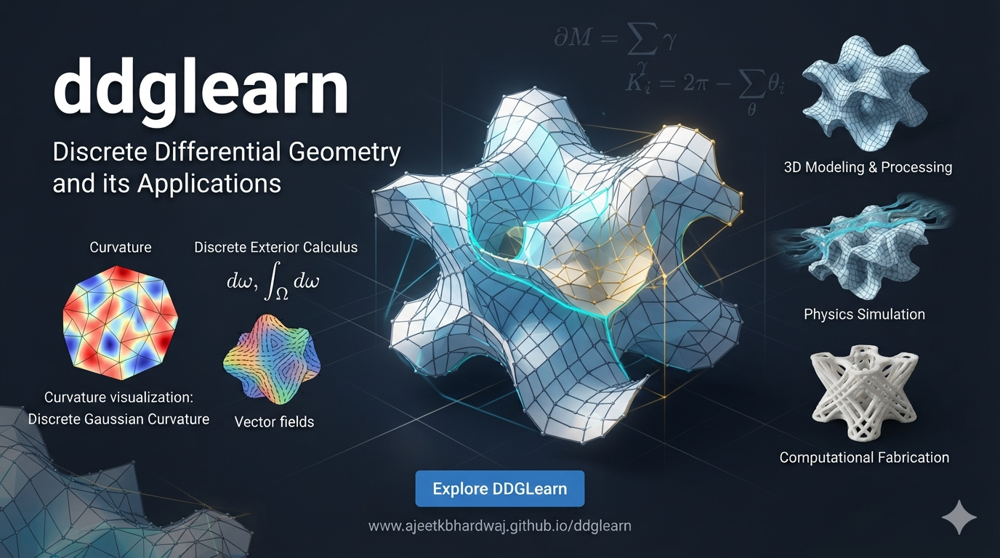

Discrete Differential Geometry studies geometric ideas—curvature, normals, geodesics, and surface deformation—using finite structures such as meshes rather than smooth mathematical surfaces. `ddglearn` is designed to make these ideas practical: users can load a mesh, compute geometric quantities, experiment with algorithms, and visualize the result.

## Why discrete geometry?

In classical differential geometry, a surface is often described as a smooth function with derivatives defined everywhere. Real-world geometry is different: 3D scans, simulations, graphics models, and medical surfaces are usually stored as discrete samples.

A triangle mesh approximates a smooth surface using:

- **Vertices**: points in 3D space.
- **Edges**: straight-line connections between vertices.
- **Faces**: usually triangles formed by three vertices.
- **Connectivity**: information describing which vertices and edges belong to which faces.

The central idea of DDG is to redefine smooth concepts—such as tangent vectors, curvature, and integration—so that they remain meaningful on these finite structures.

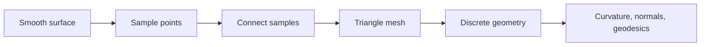

## Core data structure: the mesh

Most DDG algorithms begin with a mesh. A mesh is not only a collection of 3D coordinates; its connectivity determines the local neighborhood of every vertex.

For example, to compute curvature at a vertex, the algorithm needs to know:

- Which faces touch the vertex.
- Which vertices are its neighbors.
- The angles and areas of the surrounding triangles.
- The directions of the incident edges.

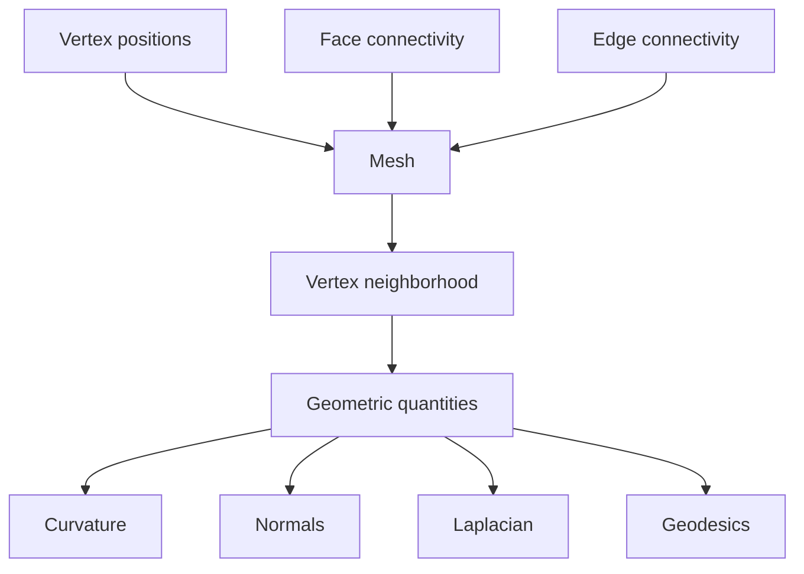

A useful mental model is that **geometry lives in the vertex positions**, while **topology lives in the connectivity**. Changing vertex positions changes the shape; changing connectivity changes the combinatorial structure of the surface.

## From mesh to differential operators

A major strength of DDG is that it converts geometric questions into matrix computations. For a mesh with $n$ vertices, many operators become sparse $n \times n$ matrices.

Common operators include:

| Concept | Discrete version | Typical use |
|---|---|---|
| Gradient | Per-face or per-edge gradient | Transport quantities across a surface |
| Divergence | Area-weighted divergence at vertices | Solve Poisson problems |
| Laplacian | Mesh Laplace-Beltrami operator | Smoothing, spectral analysis, heat flow |
| Curvature | Angle defect, mean curvature, Gaussian curvature | Shape analysis |
| Cotangent weights | Edge weights based on opposite angles | Accurate discrete operators |

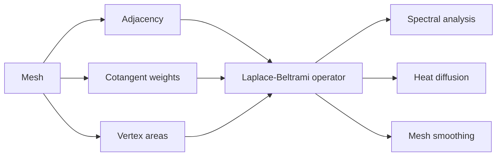

The Laplace-Beltrami operator is especially important. Intuitively, it measures how a value at a vertex compares with the values at nearby vertices. If a vertex has a much larger value than its neighbors, the Laplacian is negative; if it is smaller, the Laplacian is positive.

## Normals and local orientation

Normals describe the direction perpendicular to a surface at a point. They are essential for rendering, shading, physical simulation, and defining orientation.

For a triangular face with vertices $v_0$, $v_1$, and $v_2$, a normal can be computed from the cross product of two edge vectors:

$$
n_f = \frac{(v_1 - v_0) \times (v_2 - v_0)}{\lVert (v_1 - v_0) \times (v_2 - v_0) \rVert}
$$

A vertex normal is commonly computed as an area-weighted average of the normals of adjacent faces.

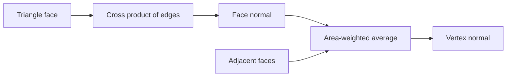

Consistent face orientation matters. If one triangle is wound clockwise and its neighbor counterclockwise, their normals may point in opposite directions, producing incorrect shading, broken boundary detection, or unreliable geometric computations.

## Curvature: how a surface bends

Curvature measures how strongly a surface bends. On a smooth surface, curvature is defined using derivatives; on a mesh, it is estimated from local geometry.

Two important types are:

- **Gaussian curvature**: the product of the two principal curvatures; it describes intrinsic bending.
- **Mean curvature**: the average of the two principal curvatures; it is often used in smoothing and surface fairing.

A simple discrete estimate of Gaussian curvature at an interior vertex uses the **angle defect**:

$$
K(v) = \frac{2\pi - \sum_i \theta_i}{A(v)}
$$

Here, $\theta_i$ are the angles at vertex $v$ in its incident triangles, and $A(v)$ is the barycentric or mixed area associated with the vertex.

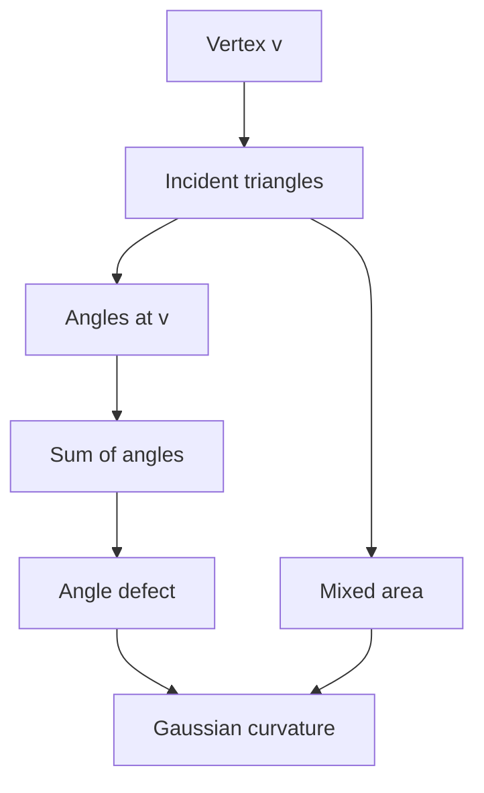

Interpretation:

- A flat vertex has an angle sum close to $2\pi$, so curvature is near zero.
- A cone-like vertex has an angle sum less than $2\pi$, giving positive curvature.
- A saddle-like vertex can have an angle sum greater than $2\pi$, giving negative curvature.

## Geodesics: shortest paths on surfaces

A geodesic is the shortest path between two points constrained to remain on a surface. On a plane, it is a straight line; on a sphere, it resembles a great-circle route.

Computing geodesics is useful for:

- Texture generation.
- Path planning on 3D surfaces.
- Measuring distances on anatomical models.
- Segmenting meshes.
- Analyzing shapes independently of their embedding in 3D space.

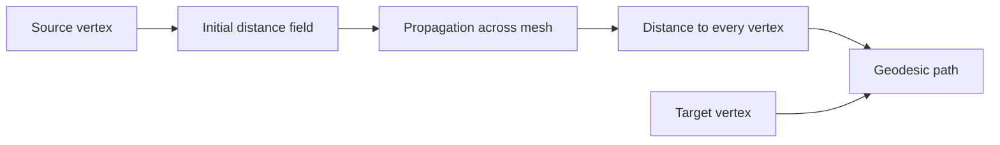

A common approach is to compute a **distance field** from a source vertex, then trace a path backward from the target by following decreasing distance values.

## Heat-based geometry

Heat methods provide an elegant way to compute distances and solve PDEs on surfaces. The idea is to release heat at a source and observe how it spreads over the mesh.

The heat equation is:

$$
\frac{\partial u}{\partial t} = \Delta u
$$

On a mesh, this becomes a sparse linear system involving the Laplace-Beltrami operator. After solving for the heat distribution, its gradient can be normalized and used to recover a vector field, from which distances can be computed.

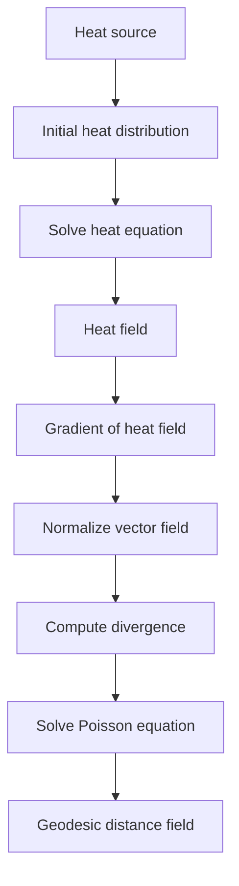

This workflow is powerful because it avoids explicitly tracing every possible path across the mesh.

## Smoothing and denoising

Real meshes often contain noise from scanning, reconstruction, or simulation. Smoothing reduces high-frequency irregularities while trying to preserve important features such as edges and corners.

A basic Laplacian smoothing update moves each vertex toward the average of its neighbors:

$$
v_i^{new} = v_i + \lambda \Delta v_i
$$

where $\lambda$ controls the strength of smoothing.

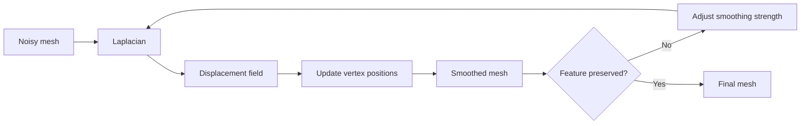

Strong smoothing can remove noise but may also erase sharp features. More advanced methods use curvature flow, feature preservation, or optimization-based fairing.

## Typical `ddglearn` workflow

A typical workflow in a DDG library follows this sequence:

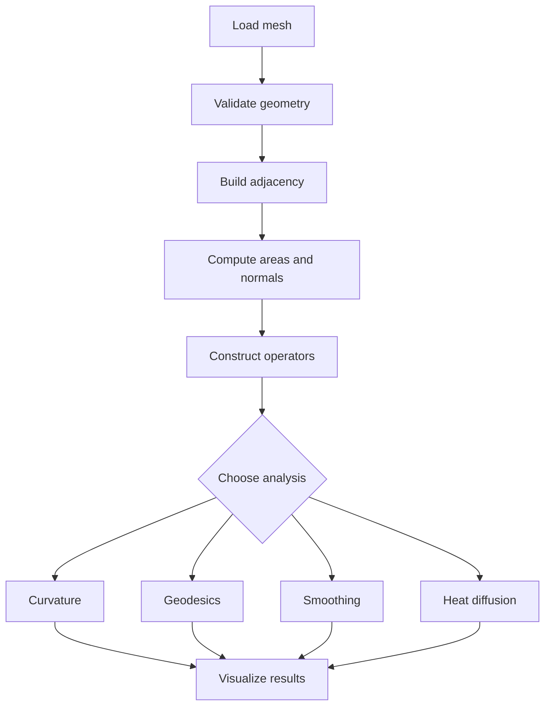

Conceptually, the library can be organized into layers:

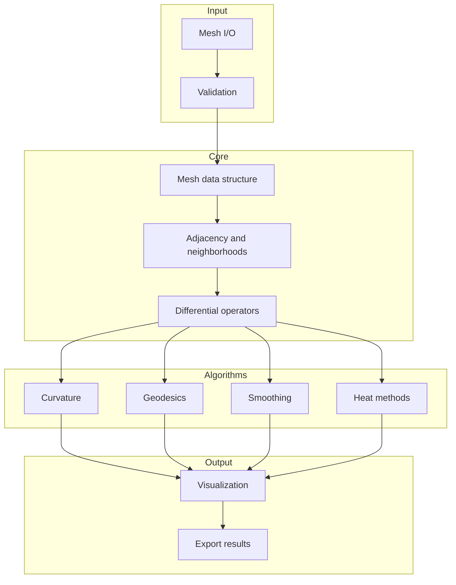

## Example conceptual API

The following pseudocode illustrates the kind of workflow a learning-oriented DDG library might expose:

```python
mesh = ddglearn.load_mesh("surface.obj")

mesh.compute_normals()
mesh.compute_vertex_areas()

curvature = ddglearn.gaussian_curvature(mesh)
laplacian = ddglearn.laplace_beltrami(mesh)

smoothed = ddglearn.smooth(mesh, strength=0.3)
distance = ddglearn.geodesic_distance(mesh, source_vertex=0)

ddglearn.visualize(mesh, scalar_field=curvature)
```

The important design principle is separation of concerns:

- **Mesh representation** stores geometry and topology.
- **Operators** translate geometry into matrices and local computations.
- **Algorithms** combine operators to solve high-level problems.
- **Visualization** makes the result interpretable.

## Applications

DDG appears across many technical domains:

| Domain | How DDG is used |
|---|---|
| Computer graphics | Mesh editing, shading, deformation, remeshing |
| Physical simulation | Cloth, shells, fluids, and elastic surfaces |
| 3D scanning | Denoising, hole filling, surface reconstruction |
| Medical imaging | Organ shape analysis and anatomical measurements |
| Architecture | Structural surface analysis and form-finding |
| Machine learning | Geometric deep learning and mesh-based neural networks |

## Conclusion

`ddglearn` can serve as both a practical geometry toolkit and a learning environment. By exposing meshes, differential operators, curvature, geodesics, and heat-based methods through code, it helps users move beyond formulas and see how geometric ideas behave on real 3D data.